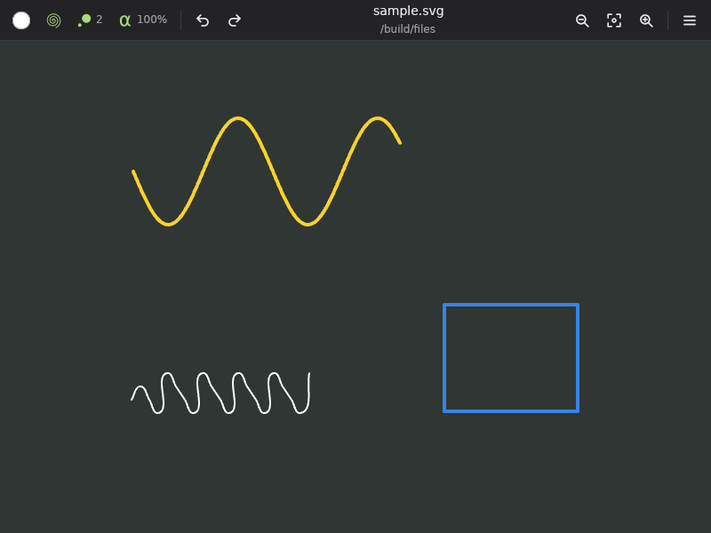

# Pizarra (GPUI)

A free-hand vector drawing application with an infinite canvas and infinite
zoom¹, rewritten on [GPUI](https://www.gpui.rs/), the GPU-accelerated UI
framework behind the Zed editor.

This is a port of [pizarra-gtk](https://gitlab.com/categulario/pizarra-gtk)
(1.7.5) by Abraham Toriz. As in the original, the interesting part (shapes,
tools, undo, transforms and the SVG file format) lives in the
[`pizarra`](https://codeberg.org/categulario/pizarra) engine crate; this
repository is the frontend: a GPUI window, toolbar, canvas renderer and the
file dialogs. The interface is in English and keeps the original's shortcuts.



## Features

- Pen, rectangle, polygon, circle (center + point, three points), ellipse
  (foci + point), grid, free grid and eraser tools.
- Stroke color (GNOME palette or custom RGB), thickness and opacity.
- Pan with the middle mouse button or the scroll wheel, rotate with
  Shift + wheel, zoom in/out/home.
- Undo / redo.
- Files are plain SVG, compatible with pizarra-gtk. SVGs made with other
  programs are imported as far as the engine understands them; in that case
  *Save* asks for a new file instead of overwriting the original.
- Export to PNG (bounding box of the drawing plus padding), rendered off the
  UI thread.
- Asks before throwing away unsaved strokes (new, open, close, quit).
- Reads the same configuration file as pizarra-gtk.

## Keyboard shortcuts

| Action | Keys |
| --- | --- |
| New / Open / Save / Save as | `Ctrl+N` / `Ctrl+O` / `Ctrl+S` / `Ctrl+Shift+S` |
| Export to PNG | `Ctrl+Shift+E` |
| Undo / Redo | `Ctrl+Z` / `Ctrl+Shift+Z` (or `Ctrl+Y`) |
| Quit | `Ctrl+Q` |
| Pen, Rectangle, Polygon | `L`, `R`, `P` |
| Circle (center), Circle (3 points), Ellipse | `C`, `K`, `E` |
| Grid, Free grid, Eraser | `Q`, `Alt+Q`, `G` |
| Color chooser | `Alt+C` |
| Zoom in / out / home | `+` / `-` / `0` |
| Full screen | `F11` |
| Cancel the shape being drawn, close popovers | `Esc` |

## Running with Nix

The flake builds for `x86_64-linux` and `aarch64-linux`:

```sh
nix run github:moeleak/pizarra-gpui            # run it
nix run github:moeleak/pizarra-gpui -- drawing.svg
nix build                                       # ./result/bin/pizarra-gpui
nix develop                                     # cargo, rustc, clippy, rust-analyzer
nix flake check
```

The package installs a desktop entry and icon, and patches the binary's
RUNPATH with the libraries GPUI loads at runtime (Vulkan loader, Wayland,
xkbcommon, X11/xcb, fontconfig). Inside `nix develop` those are on
`LD_LIBRARY_PATH`, so `cargo run` works directly.

GPUI renders with Vulkan, so the host needs a Vulkan driver. On NixOS that is
`hardware.graphics.enable = true`. On other distributions, a Nix-built binary
may need [nixGL](https://github.com/nix-community/nixGL) to find the host's
driver.

### Graphics tablets

Graphics tablets are supported natively: pen pressure modulates the stroke
width, and the eraser end of the stylus temporarily switches to the eraser
tool. This works through XInput on X11/XWayland, through the
`tablet-unstable-v2` Wayland protocol and through the tablet data of AppKit
mouse events on macOS. A mouse or trackpad always draws at the configured
width.

The pressure button in the header bar (or `Alt+P`) turns pressure off, so the
pen also draws at the configured width; `pen_pressure` in the configuration
sets how the app starts.

Pizarra prefers native Wayland when the session provides a
`zwp_tablet_manager_v2`. Set `PIZARRA_BACKEND=x11` to force the X11 backend
(XWayland on a Wayland session), or `PIZARRA_BACKEND=wayland` to force native
Wayland. On Wayland the lower stylus button pans the canvas, like the middle
mouse button.

On macOS the stylus buttons do whatever the tablet driver maps them to. A
tablet needs its vendor's driver installed for macOS to report pressure.

## Building without Nix

You need a recent stable Rust and the development packages for
fontconfig, freetype, libxkbcommon, libxcb, libX11, Wayland and the Vulkan
loader (e.g. on Debian/Ubuntu: `libfontconfig-dev libfreetype-dev
libxkbcommon-x11-dev libxcb1-dev libx11-dev libwayland-dev libvulkan-dev`).
On macOS without Xcode (only the Command Line Tools), add
`--features gpui/runtime_shaders`: the Metal shader compiler ships with Xcode.

Two dependencies come from forks, fetched by Cargo over git:
[moeleak/pizarra](https://github.com/moeleak/pizarra) (the drawing engine,
with pressure support) and the `gpui-v0.2.2-tablet` branch of
[moeleak/zed](https://github.com/moeleak/zed/tree/gpui-v0.2.2-tablet)
(GPUI 0.2.2 with tablet events).

```sh
cargo run --release -- [drawing.svg]
cargo test
```

Open/save dialogs go through the XDG desktop portal (`xdg-desktop-portal`
plus a backend such as `-gtk`, `-gnome` or `-kde`).

## Configuration

Like pizarra-gtk, the configuration is read from `$PIZARRA_CONFIG` or
`~/.config/pizarra/config.toml`, and a default file is written there on
first run:

```toml
thickness = 2.0            # starting stroke width
export_padding = 20.0      # PNG/SVG margin around the drawing
erase_radius = 10.0
point_snap_radius = 10.0
zoom_factor = 2.0
background_color = "#303633FF"  # chalkboard
stroke_color = "#FFFFFFFF"
scroll_factor = -5.0       # pixels per wheel notch (sign = direction)
pen_pressure = true        # pen pressure varies the stroke width (Alt+P)
```

`pen_pressure` is read only by this frontend; pizarra-gtk ignores it.

## Differences from pizarra-gtk

- Uses pizarra engine 3.0.1 (pizarra-gtk 1.7.5 used 2.0.4).
- GTK's color chooser, scale buttons and header bar are replaced by GPUI
  popovers. A palette, RGB sliders, and thickness/opacity sliders that also
  respond to the scroll wheel.
- Undo/redo buttons in the header bar; *Full screen* (`F11`) now works.
- Fills are painted under strokes. With cairo, stroking consumed the path, so
  a shape with both lost its fill.
- Pen pressure changes the stroke width, and a stylus' eraser end selects the
  eraser automatically. A pressure stroke is one shape, so the eraser removes
  it whole. It is saved as one SVG path per segment, because SVG has no
  variable stroke width, numbered with `pizarra:pressure-segment` so that
  loading joins the segments back into one stroke (pizarra-gtk loads them as
  separate paths).
- Saving writes to a temporary file and renames it, so a failed save never
  truncates the drawing.

## Layout

```
src/main.rs      startup, CLI, window
src/app.rs       the window view: header bar, popovers, input, file flows
src/canvas.rs    GPUI path tessellation and the cached layer of stored shapes
src/geometry.rs  pizarra draw commands → renderer-agnostic paths (unit tested)
src/export.rs    PNG export with tiny-skia
src/config.rs    configuration file
src/prompt.rs    themed dialogs
nix/package.nix  the Nix package; flake.nix wires it up
```

## License

GPL-3.0-or-later, like pizarra-gtk. The tool icons and the application icon
come from pizarra-gtk.

---

1. The canvas and zoom are bounded by 64-bit floating point precision, which
   for everyday use is a very large drawing space.
